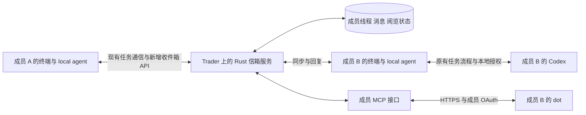

# 成员收件箱与 dot 接入实施计划

日期：2026-10-12。状态：架构与最小范围已确认，以下为待实现方案。

第一期交付一个按成员归属的持久收件箱。成员可以在 xXASSXx 终端或自己的 dot 中查看同一段协作记录，并通过 dot 发出明确授权的留言与回复。任务执行、文件访问和本地授权继续由现有 local agent 与 Rust 内核管理。

这解决两个问题：别人联系我以后，我有稳定的地方发现并接续；更换交互入口以后，协作历史和责任不会分散在不同 agent 的聊天里。

## 一期范围

| 能力 | 本期交付 |
| --- | --- |
| 成员收件箱 | 全部、未读、需要我处理三种视图；按协作线程聚合 |
| 消息与任务 | 普通留言与回复；已有任务的请求、问题、重要进展、结果和附件状态 |
| 终端入口 | 全局未读提示、收件箱列表、详情、回复、跳转原任务和本地授权入口 |
| dot 接入 | 成员绑定、查身份与联系人、列收件箱、读线程、发送留言、回复 |
| 持久与离线 | 服务器保存历史；终端缓存、断线提示、恢复同步、幂等重试 |
| 权限 | 每个连接绑定一个成员；只访问本人参与且获准访问的线程 |

本期不包含 dot 主动唤醒提醒、操作系统通知、通用技能目录、技能自动安装、目录打包分卷、新的文件传输协议、多人群聊、跨成员身份合并，以及通过 dot 发起或授权执行任务。附件在收件箱中显示已有清单和真实交付状态；dot 本期不下载附件正文。

因此，一期可以让 B 在打开终端或询问 dot 时发现 A 的联系；B 没有打开任何入口时，尚不保证主动提醒。已有获准任务仍可由后台处理，普通留言不会自动启动 Codex。

## 现有基础与改动边界

现有 `/v1/inbox` 是后台通信队列，ACK 后不再出现在待收列表。它服务消息运输，不能直接作为给人看的持久收件箱。`relay_messages` 已保留消息，任务事实、会议与结果也有既有记录，可以作为新收件箱的来源。

终端目前有会话及事件游标产生的未读计数，但没有覆盖所有协作线程的统一成员收件箱。新的成员未读状态单独维护，保留现有本地聊天记录。

现有 `src/mcp.rs` 是受限任务执行接口，`src/butler_mcp.rs` 是本地协调接口。云端 dot 使用新的成员接口，不取得执行实例凭据，也不调用任务结果提交或授权写入接口。

本计划基于当前个人端 schema 9、信箱 schema 1，以及尚未提交发布的 `0.5.0-alpha` 更新器工作。实施前重新检查工作区和现用版本，保留已有修改；功能提交、版本升级和安装安排单独记录。

## 总体架构与职责

在现有 Trader 服务上增加收件箱业务模块与远程 MCP 接口，沿用 Rust、Axum、SQLite 和 HTTPS 部署。业务规则只实现一次，由终端使用的 HTTP API 与 MCP 工具共同调用。不另建消息服务器、消息中间件或 agent 调度平台。

服务器保存已提交的协作消息、参与者权限、收件箱视图和成员阅览状态。本地保留缓存、待发送记录和原任务数据；任务执行状态仍由有权报告该事实的协调方或执行方产生。服务器汇总这些事实，附上来源、版本与更新时间，不自行推断任务已经完成。

只纳入已跨成员提交的业务内容，以及本功能所需的最少状态事实。本地个人聊天、模型推理记录、原始目录和文件正文不因为新增收件箱而自动上传。新增本地待办状态上报沿用持久 outbox，省略本机绝对路径与凭据；只面向本人展示的待办事实保持成员私有。

电脑离线时，dot 仍可查看已到达服务器的内容并发送留言。尚未同步的本地消息或进展不属于云端已知事实；涉及本机操作的事项仍等待本机在线及本地授权。

一期以现有 `member_id` 为收件箱归属。当前 `owner` 与 `mba` 是两个成员身份，即使属于同一个人也不自动合并。连接时明确显示所绑定的成员。

## 线程与状态模型

任务按 `task_id` 聚合成线程，修订号保留在事件中。普通联系创建独立通信线程，后续回复使用该线程编号；同一对成员可以有多个主题。第一期不支持临时加人或转发整个线程。

线程聚合不扩大消息可见范围。已有任务涉及多个成员时，每个条目仍按原发送者、接收者和明确授权范围过滤；同为任务参与者不意味着能查看其他两人之间的全部对话。列表摘要、未读数、附件元数据和回复目标使用相同过滤规则。回复沿目标条目的通信关系确定收件人，不自动广播给整个任务。

| 数据对象 | 核心内容与约束 |
| --- | --- |
| `inbox_threads` | 类型、主题、可选任务编号、最近业务活动；关联现有任务，不复制执行控制状态 |
| `inbox_participants` | 成员与线程关系；每次读取和写入检查，不能仅凭知道线程编号访问 |
| `inbox_entries` | 稳定条目编号、源事件编号、线程序号、作者成员、可见成员、发出入口、类型、正文、回复目标、任务修订、时间 |
| `inbox_member_state` | 成员在线程中的本人阅览游标；列表抓取与模型读取不修改它 |
| `inbox_actor_receipts` | dot 等客户端读到的位置，与本人阅览状态分开 |
| 本地同步记录 | 成员变更游标、缓存、发送 outbox、阅览同步 outbox、错误与重试状态 |
| 成员连接记录 | OAuth 主体与成员映射、权限范围、撤销状态；凭据不进入业务消息 |

表名为实施命名建议。任务是否需要人处理，从已有任务问题、授权与责任事实生成投影；没有充分事实时显示“状态待同步”，不根据自由文本猜测。

以下状态相互独立，不能合并成一条含糊的“已读”链路：

| 状态 | 实际含义 |
| --- | --- |
| 待发送 | 消息只在本地 outbox，尚未得到服务器持久化确认 |
| 已进入对方收件箱 | 服务器已持久保存，接收方有权查询 |
| 对方后台已同步 | 接收方后台已保存到本地；沿用或单独记录对应同步凭据 |
| agent 已处理 | 存在对应业务处理证据；读取工具返回成功不等于处理完成 |
| 本人已查看 | 终端显示到该位置后确认阅览，或本人明确标记；不声称理解了内容 |
| 需要我处理 | 当前任务事实指向本人，例如本地执行授权、待回答问题；查看与回复不会自动清除此状态 |

收件箱的“未读”按线程计算，只考虑面向该成员的业务条目。心跳、重试、token 使用量等内部事件不制造未读。任务状态更新不拆成大量新线程。本人阅览状态一期仅服务自己的收件箱，不对其他成员宣称人已经读懂或同意。

## 消息写入与同步规则

1. 服务器接收任务业务事件时，在同一事务内保存原消息和收件箱条目；通过稳定源编号去重。新增普通留言直接写入收件箱业务表。
2. 新留言采用独立的通信类型，经新增收件箱同步接口传给个人后台，不放进可能触发执行的旧 `operation=auto` 请求路径。
3. 同步使用服务器生成的单调游标和分页。客户端先持久保存本批条目，再推进游标；重启或重复拉取不会重复显示、重复回复或启动任务。
4. 所有发送都携带幂等键。同一身份、同一键、同一内容返回原结果；同键不同内容报冲突。发出后断网可以查询并重试，不能凭超时断言发送失败。
5. 阅览提交明确的 `through_seq`，服务端单调合并。阅览期间新到的消息仍保持未读；离线阅览恢复后可以同步，dot 读取不能推进本人的游标。
6. 任务事实保留来源成员、修订及源序号。迟到的旧版本不得覆盖当前状态；“需要我处理”由对应问题或授权事实的解决事件清除。
7. 普通回复只追加通信内容。对任务问题的正式回答仍走已有绑定 `question_id` 与修订号的入口，执行授权仍留在执行方本地。输入“同意”或“开始运行”不会成为内核授权。
8. 获取消息不触发自动回复；dot 与 local agent 不相互默认唤醒，避免两个 agent 围绕一条留言持续对话。

服务器另提供按成员分页的变更流，覆盖新条目与本人阅览状态变化。共享收件箱的多个界面可以收敛到相同状态；个人后台的运输 ACK、收件箱同步游标、dot 读取记录始终分离。

## 共用业务接口与 MCP 工具

先实现与传输协议无关的 `InboxService`，输入已验证的调用身份。HTTP 和 MCP 只负责协议适配、参数解析与错误返回，不各自实现一套权限和业务状态转换。

| 操作 | 主要输入与输出 | dot 权限 |
| --- | --- | --- |
| `get_identity` | 当前成员、团队、已授权能力 | 只读 |
| `list_contacts` | 团队中允许联系的成员编号与显示名 | 只读 |
| `list_inbox` | 全部／未读／需要我处理、分页游标；返回摘要和最近同步时间 | 只读 |
| `read_thread` | 线程编号、分页位置；返回可见历史、任务事实、附件元数据 | 只读；不清除本人未读 |
| `send_message` | 收件成员、主题、正文、幂等键；返回线程、消息和持久化状态 | 发送权限 |
| `reply_to_thread` | 线程、回复目标条目、正文、幂等键；返回消息和持久化状态 | 发送权限 |

个人终端另使用同步与本人阅览接口；一期不向 dot 提供修改本人阅览游标的工具。日后如果确需“替我标为已读”，增加单独工具和权限，不能附带在阅读操作里。

`sender` 与成员身份来自认证上下文，不让模型通过参数指定。回复目标必须属于当前线程且对调用者可见；任务已修订时返回当前修订信息，普通留言仍只是留言。客户端显示回复关联，避免把上一版问题的回复解释为当前任务决定。

列表和正文均限制大小并分页，返回明确错误：未连接、无权限、成员不存在、线程不可见、冲突、限流、暂时不可用。日志记录关联编号、调用身份、入口与结果，默认不打印正文和令牌。远端消息作为资料展示，不作为工具执行指令。

工具说明及权限声明区分查询与发送；允许连接和读取不等于允许自动外发。dot 发送必须遵守成员在当前交互中的指示，收到另一位成员的要求本身不构成该成员的发送授权。服务端记录这是委托客户端发出的消息，不伪称成员亲自键入。

## dot 连接与成员认证

dot 使用已安装并获准启用的插件能力，实际可用性受账号、工作区及运行环境影响，所以真实 dot 连接是实施的第一道验证。[dot 的电脑与应用说明](https://learn.chatgpt.com/docs/dots/computers-and-apps)

新 MCP 端点采用 HTTPS 和成员 OAuth。OpenAI 当前文档要求受保护 MCP 接口支持 OAuth 授权码流程与 PKCE，并校验令牌签发者、受众、有效期及权限。既有设备令牌仍用于个人后台，不直接交给云端插件。[MCP 认证说明](https://developers.openai.com/plugins/build/auth)

具体连接流程：管理员把 OAuth 主体绑定到已有团队成员；成员在插件连接页登录，确认绑定成员和“读取协作收件箱／发送协作消息”权限；MCP 从验证后的主体解析成员。未绑定主体不能自选任意 `member_id`。成员撤销连接或退出团队后，每次请求的成员检查立即阻止继续访问。

采用成熟 OAuth 授权服务或组件，优先复用团队已有服务；没有现成服务时，在技术验证阶段比较并锁定一个维护成本低的方案。第一期只配置受邀成员和一个 MCP 应用，不开发自助注册、密码找回或通用组织管理。必须完成实际授权、刷新、撤销和成员隔离后再接真实协作内容。

认证组件和远程 MCP 实现依赖在阶段 0 锁定。默认 Rust 内部署业务与 MCP 适配；若现成 Rust 协议库与 dot 存在已证实的不兼容，允许使用官方支持的 SDK 做薄适配进程，业务数据和规则仍留在 Rust。不要在尚未验证的库上承诺兼容全部协议版本。

本期按个人或团队内部连接验收，不把公开插件商店上架作为前置条件。插件管理界面的具体配置以实际账号支持的入口为准；不能假设填入一个静态 Bearer token 就能完成连接。公开提交入口目前不提供 API key／Bearer token 输入流程。[插件连接限制](https://developers.openai.com/plugins/deploy/submission)

## 终端体验

增加 `/inbox` 确定性入口与全局未读数量，不用自然语言模型猜测是否打开收件箱。列表默认按最近业务活动排序，可切换“未读”和“需要我处理”，每行显示联系人、主题、最近内容、任务状态与下一步责任。

进入详情后展示同一线程的原话、回复、重要任务事实与附件状态。提供“回复”和“打开相关任务”；任务需要授权时指向现有本地授权页，明确写出应由哪个成员在哪台执行端处理。普通回复输入区明确表示只发送留言。

阅览确认以真正显示到的内容序号为界限，不能因为列表被后台刷新就清空未读。阅读和解决待办分别呈现。断线时显示缓存及上次同步时间，发送显示“待发送”，恢复后更新实际状态；不把模型生成的摘要当成完整原始记录。

## 迁移与兼容

新增个人缓存与服务器业务表，按正式 schema 迁移处理；以当前基线预计个人端 9→10、信箱 1→2，实际编号以实施时最新主线为准。尤其要整理信箱目前在任务调度迁移中写 `user_version=1` 的逻辑，避免启动后把新版本号覆盖回去。

迁移只增量转换，不重新初始化成员、配置、白名单、授权或历史。由已有持久消息重建可确定的线程；稳定源编号保证可重复执行。没有历史阅览证据的内容标为“历史记录，阅览状态未知”，作为启用前基线，不制造大量新未读，也不伪造已查看回执。历史未解决的有效待办仍进入“需要我处理”。

一期不自动清理收件箱正文；查看和任务归档都不删除历史。文件继续使用现有保存与过期规则，收件箱明确区分“有附件记录”和“文件仍可领取”。运维记录数据库大小和同步失败，后续按实际增长决定保留期限。

新服务器保持原任务与文件传输接口兼容。新个人端探测收件箱能力；旧服务器明确显示暂不支持。普通留言使用独立同步路径，旧客户端不会误当执行请求；对方旧客户端尚不能在终端看到新留言时，发送端说明需要新版终端或 dot 查看，不能声称后台已同步。

部署顺序为服务器、试用个人端、dot 连接，再推广其他成员。跨 schema 升级不能经过当前仅支持同 schema 的自动更新路径：本期提供明确的停服、状态检查、增量迁移和恢复操作，不顺便扩成通用跨版本更新器。迁移前应保留可恢复数据库和配置副本；如该次部署明确另有安排，记录恢复能力的实际限制。旧二进制不得直接打开新 schema，单独换回二进制不构成数据库回退。

版本号在功能冻结时按实际最新发布版本递增；如果 `0.5.0-alpha` 先作为更新器版本发布，本期可使用 `0.6.0-alpha`。计划阶段不改版本、不打包、不安装。

## 实施阶段与交付物

| 阶段 | 工作 | 结束条件 |
| --- | --- | --- |
| 0 真实连接验证 | 检查当前账号 dot 插件入口；用隔离数据接通 HTTPS、MCP、成员 OAuth；锁定授权组件、SDK 与协议；记录部署配置 | 真正的 dot 能查询自己的测试身份；错误身份拒绝；刷新及撤销验证完成 |
| 1 收件箱内核 | 数据模型、迁移、稳定线程映射、业务条目、权限、幂等写入、任务事实投影、变更流 | HTTP 层通过双成员、离线、重复、乱序及越权回归；运输队列行为保留 |
| 2 终端接入 | 本地缓存和 outbox、全局入口、三个筛选、详情、阅览、回复、原任务跳转 | 两端真实 TUI 完成联系、发现、查看、回复；离线恢复后状态一致 |
| 3 完整 dot 接入 | 六个工具接到同一业务层；内部插件配置；成员映射、权限、日志与限流 | 真正的 dot 读取终端同一线程，并在成员指示下回复；发送方真实终端收到内容 |
| 4 兼容与交付 | 旧数据迁移、旧客户端兼容、任务及附件回归、M 系 Mac / Linux 构建、文档和安装验证 | 完成下表验收，有可核对的最终答复；按届时授权提交、发布和升级 |

阶段 0 的外部连接失败不阻止收件箱内核与终端工作，但不能把 MCP 模拟客户端成功写成 dot 已接通。每个阶段形成可独立检查的改动；当前未提交的更新器改动保留，不混作本功能的验证证据。

建议代码落点：`src/inbox/` 放业务模型、查询、写入与投影；`src/mailbox.rs` 接 HTTP 和现有事件；`src/team.rs` 与个人后台接缓存同步；`src/tui/inbox.rs` 接终端面板；独立 `src/member_mcp.rs` 与认证模块接成员 MCP。迁移和测试遵循现有项目结构。现有执行 MCP、任务调度与文件传输只增加必要事件衔接。

交付文档包括本计划、接口与迁移说明、dot 连接说明、终端操作说明、精简验收记录与对应发布说明。README 只增加团队使用者需要的入口；开发状态继续记录在 `current-state.md`。

## 一期验收标准

| 场景 | 必须看到的结果 |
| --- | --- |
| A 联系 B | B 收件箱出现一个线程，原话、发起成员与下一步责任正确；A 只看到有证据的送达状态 |
| B 后台已处理而本人未打开 | B 的本人未读仍保留；执行或回复完成不等于本人看过 |
| dot 先读取 | dot 与终端取得同一线程；终端本人未读不消失 |
| B 指示 dot 回复 | A 的真实终端收到一条准确归属 B、注明经 dot 发出的回复，关联原线程 |
| B 电脑离线 | dot 可读服务器已有历史并回复；电脑恢复后补齐一次，不重复显示或执行 |
| 断线与重复 | 在保存、响应、ACK 等边界断线或重启，消息不丢、不重复；超时后的结果可查询 |
| 阅览并发 | 本人阅览到序号 N 时到达的 N+1 仍未读；另一个 dot 连接不改变本人游标 |
| 任务变化 | 旧修订的迟到事件不覆盖新修订；普通留言不能消除授权待办或启动执行 |
| 成员隔离 | A 不能读取不参与的 B/C 线程，也不能因参加同一任务而看到 B/C 私有条目；摘要和未读数不泄漏；伪造作者、回复目标、撤销连接和退出成员均被拒绝 |
| 迁移兼容 | 原身份、配置、授权、会话、任务与附件记录保留；旧客户端仍能完成原协议任务 |
| 已有能力回归 | 经真实终端确认的小型任务到达有意义的最终答复，执行成员正确；相关附件传输仍可核对 |

按 `docs/debugging.md` 亲自操作真实 TUI；原生终端工具不可用时使用真实 PTY 并保存画面。第一轮使用隔离成员与小数据；现用成员验证只在届时已有授权范围内进行。核对真实模型与执行次数，不靠直接改数据库或 SSH 搬运业务结果制造成功。

自动回归、模拟模型、真实终端、真实 dot 和真实模型分别记录。发布前运行相关及完整测试、格式、Clippy、M 系 Mac / Linux 构建和安装检查。日志和精简证据包含身份、构建哈希、线程／任务关联、操作、最终答复与未验证事项，不包含令牌和私人消息正文。

## 后续主动提醒

一期稳定后，第二期增加 MCP Events。只从明确业务变化产生事件，例如首次联系、需要本人处理和结果已可领取；订阅按成员过滤，持久保存，支持去重、重试、过期和取消。事件通知提示有变化，完整内容仍从收件箱读取。

当前 OpenAI 文档说明 dot 支持 MCP Events，需要 MCP 2.0 `2026-07-28`、持久订阅和 HTTPS webhook。服务器现有 `/v2/events` 是内部任务事件接口，不能当作已经兼容 MCP Events。第二期须单独实现回调验证、签名、地址安全检查及投递 outbox，并实测 dot 按用户设置作出响应；webhook 返回 2xx 只证明平台接收，不证明本人获知。[MCP Events 文档](https://developers.openai.com/plugins/build/mcp-events)

一期保留稳定业务事件编号及可增量读取的记录，第二期从该边界接入通知，无需改写任务执行链路。技能目录与目录分卷传输继续作为独立后续项目评估。
